<div align="center">

# Solo License

**Autonomy is earned, not assumed.**<br/>
Solo License is the control layer for coding agents. It lets an agent earn the right to act without
interrupting you—one action type, one repository, and one verified outcome at a time. A failure or an
over-scoped turn revokes that right immediately.

*Earned. Revocable. Priced.*

```bash
uvx --refresh --from 'git+https://github.com/JAYATIAHUJA/Solo_license@main' solo-license onboard
```

[Live website](https://solo-license.vercel.app/) · [One-command setup](#one-command-install) · [Architecture](#architecture-at-a-glance) · [Hackathon evidence](#product-tour--evidence-from-a-real-run)

Built for the [neatHack AI agent hackathon](https://neatlogs.com/hackathon) · uses **neatlogs**, **Entire** and **cfo.ai** · by [@JAYATIAHUJA](https://github.com/JAYATIAHUJA), [@VanshNagpal10](https://github.com/VanshNagpal10) & [@areycruzer](https://github.com/areycruzer)

</div>

<p align="center">
  <a href="https://solo-license.vercel.app/"></a>
</p>

> **The simple promise:** stop approving the same safe action repeatedly without giving an agent blanket access.
> Solo License starts an action at **L0 (ask)**, promotes it through verified successful work, and demotes it on failure.

---

**Every feature, and where to find it (CLI, dashboard, plugin): [docs/FEATURES.md](docs/FEATURES.md).**
**The cfo.ai financial model: [cfo.ai/s/0dIxb9IUbPUqQKft](https://cfo.ai/s/0dIxb9IUbPUqQKft).**

| Contents |
|---|
| [The problem](#the-problem) · [What it does](#what-it-does-inside-your-agent) · [Install](#install---one-line-any-agent) · [Tech stack](#tech-stack) · [How trust is earned](#how-trust-is-earned) · [End-of-turn check](#the-end-of-turn-check) · [Control layer](#the-control-layer) · [Results](#results) · [Compared with the alternatives](#compared-with-the-alternatives) · [Hackathon tools](#how-the-three-hackathon-tools-are-used) · [Entire: logs, checkpoints, trails](#entire-logs-checkpoints-and-trails) · [neatlogs](#neatlogs-one-trace-per-turn) · [Build log](#build-log) · [Evidence](#evidence-for-judges) · [Run locally](#run-it-locally) · [Architecture](#architecture) |

## Product tour — evidence from a real run

These screens are from a live local run: the gate received native agent-hook events, recorded the decisions,
promoted verified action classes, and emitted the trace and audit evidence shown below. They are not mockups.

<table>
  <tr>
    <td width="50%" valign="top"><strong>Earned autonomy dashboard</strong><br />Action classes have independent L0–L2 levels. In this run, reading files and running tests reached L2 while edits and remote Git actions remained constrained.<br /><br />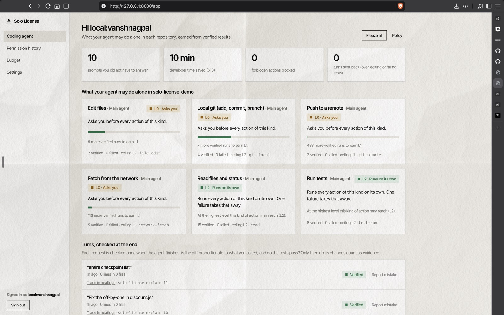</td>
    <td width="50%" valign="top"><strong>Every permission decision</strong><br />The dashboard distinguishes what the person approved from what the agent ran on its own, and links each decision to its trace.<br /><br />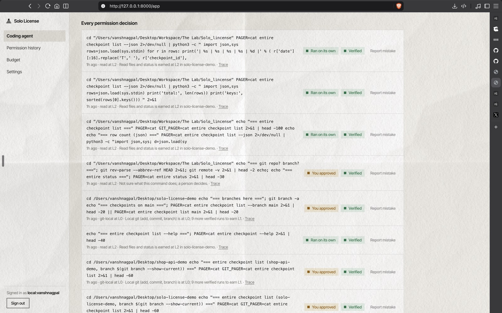</td>
  </tr>
  <tr>
    <td width="50%" valign="top"><strong>Auditable promotion history</strong><br />A promotion or demotion becomes an entry in the Git-backed license ledger and can be tied to an Entire checkpoint.<br /><br />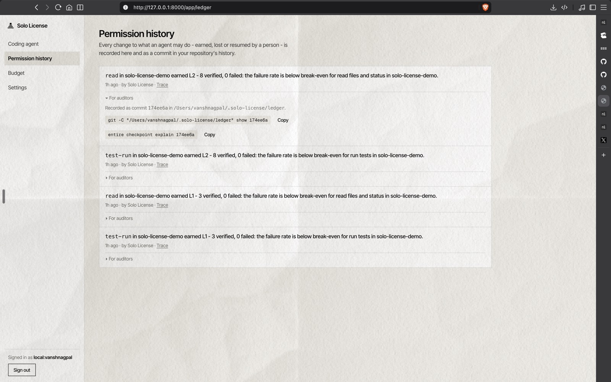</td>
    <td width="50%" valign="top"><strong>Live policy controls</strong><br />A person can cap each action class at L0, L1, or the built-in ceiling, or freeze all autonomy at once. Repository policy can only make the agent ask more.<br /><br />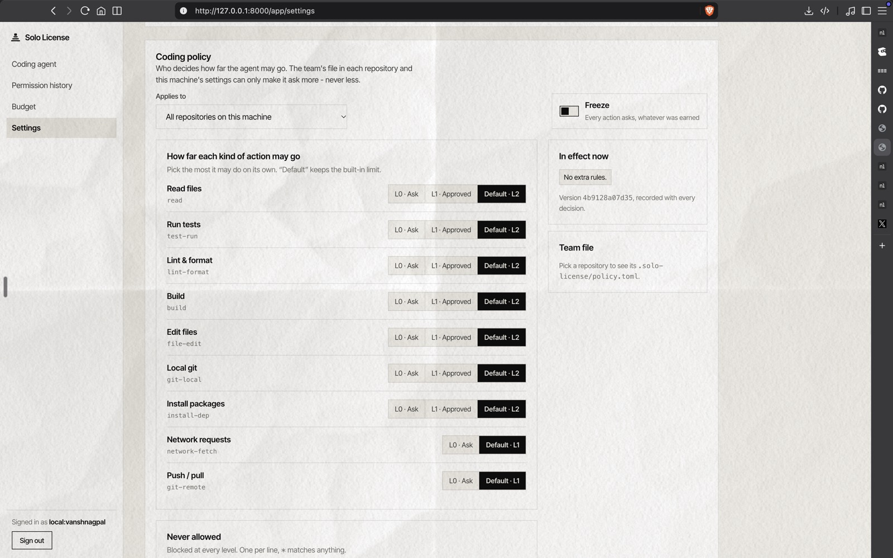</td>
  </tr>
  <tr>
    <td width="50%" valign="top"><strong>neatlogs trace</strong><br />A turn is observable end to end: start, gate decision, human approval when needed, tool execution, verification, and the final license change.<br /><br />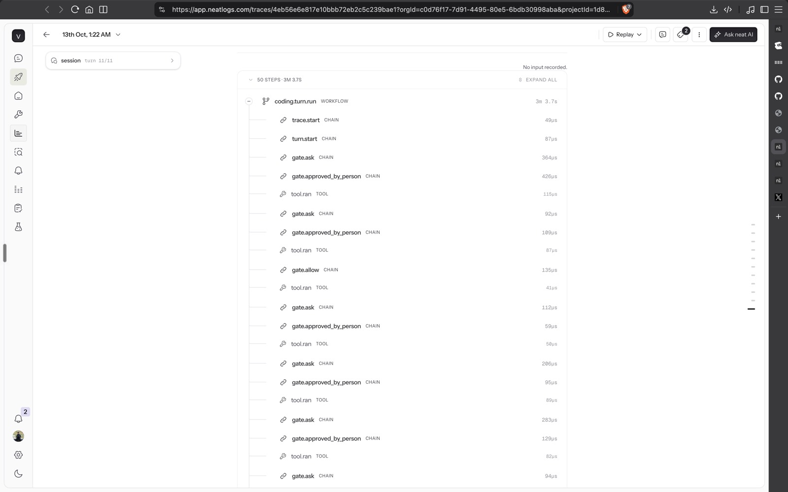</td>
    <td width="50%" valign="top"><strong>Budget view</strong><br />Token and model spend are shown beside the developer time saved by earned autonomy, with policy-based session and daily caps available.<br /><br />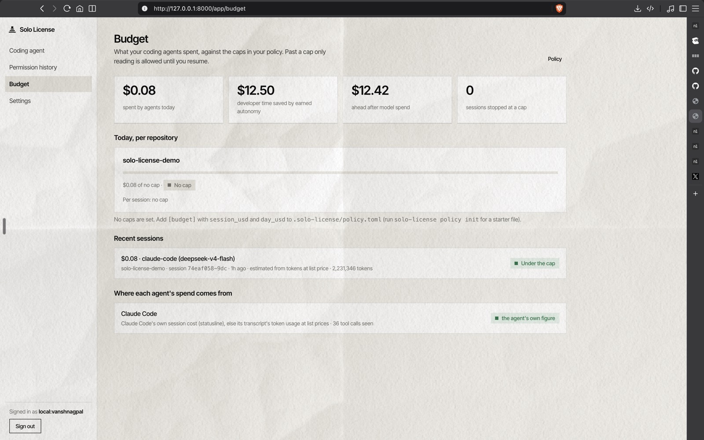</td>
  </tr>
  <tr>
    <td width="50%" valign="top"><strong>Entire analytics</strong><br />Entire provides the code-history side of the evidence: checkpoints, trails, commits, and token activity around the work.<br /><br />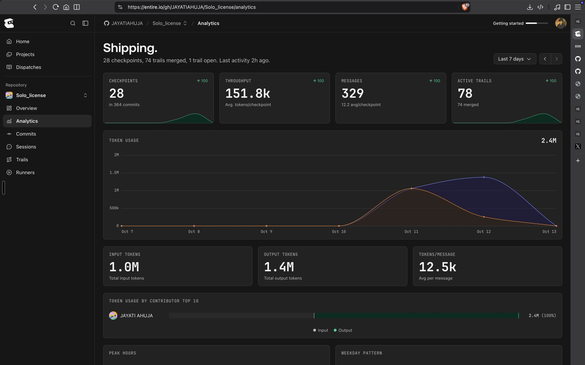</td>
    <td width="50%" valign="top"><strong>cfo.ai financial model</strong><br />The economics model turns fewer repeated approvals and fewer incidents into a transparent pricing and break-even case.<br /><br />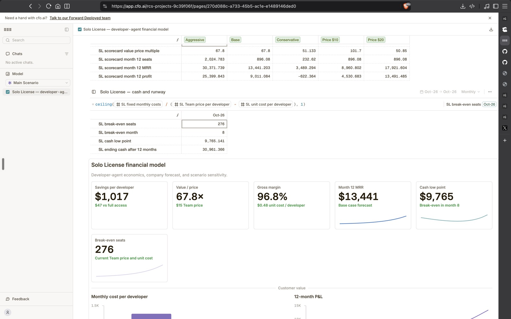</td>
  </tr>
</table>

## The problem

Every coding agent offers two bad deals:

- **"Ask before changes"** - you approve `npm test` forty times a day, until you stop reading what you approve.
- **"Full access"** - nothing interrupts you, until a force-push, a reverted commit, or a one-line bug fix that comes back as a fifty-line diff you now have to review.

Claude Code's auto mode asks *"is this action dangerous?"*. Solo License asks a different question:
**has this agent earned this kind of action, in this repo, and did it actually work?** The two work side by side.

### Why it matters (each line links its source)

- 87% of developers are concerned about the accuracy of AI agents - [Stack Overflow Developer Survey 2025](https://survey.stackoverflow.co/2025/ai).
- A Replit agent reportedly deleted a production database during a code freeze - [AI Incident Database #1152](https://incidentdatabase.ai/cite/1152/).
- Cursor's forum calls a destructive delete script slipping past its checks "a known limitation" - [Cursor forum](https://forum.cursor.com/t/agent-ran-destructive-delete-script-on-dev-vault-without-warning/165459).
- Knowledge workers who trust GenAI more report less critical thinking (319 people, CHI 2025) - [Microsoft Research](https://www.microsoft.com/en-us/research/publication/the-impact-of-generative-ai-on-critical-thinking-self-reported-reductions-in-cognitive-effort-and-confidence-effects-from-a-survey-of-knowledge-workers/).
- In an early-2025 randomized study, experienced open-source developers were 19% slower with AI tools, while believing they were faster - [METR](https://metr.org/blog/2025-07-10-early-2025-ai-experienced-os-dev-study/).
- Agents on τ-bench succeeded on under half of tasks (GPT-4o, 2024) - [arXiv 2406.12045](https://arxiv.org/abs/2406.12045).
- More than a quarter of new code at Google is generated by AI (Q3 2024) - [Google](https://blog.google/inside-google/message-ceo/alphabet-earnings-q3-2024/).
- GitHub Copilot has 20 million all-time users (July 2025) - [Microsoft FY25 Q4](https://www.microsoft.com/en-us/investor/events/fy-2025/earnings-fy-2025-q4).
- Gartner predicts over 40% of agentic AI projects will be cancelled by the end of 2027 - [Gartner](https://www.gartner.com/en/newsroom/press-releases/2025-06-25-gartner-predicts-over-40-percent-of-agentic-ai-projects-will-be-canceled-by-end-of-2027).
- AWS describes graduated autonomy for agents, where "Demotion is immediate" - [AWS Architecture Blog](https://aws.amazon.com/blogs/architecture/closing-the-ai-agent-trust-gap-with-graduated-autonomy/).

Agents are getting more capable - Claude Sonnet 4.5 scored 77.2% on SWE-bench Verified (Sep 2025,
[Anthropic](https://www.anthropic.com/news/claude-sonnet-4-5)) - which is exactly why the question is no longer
"can it?" but "has it earned the right to, here?".

## What it does inside your agent

```text
> fix the off-by-one in discount.js
⏺ Bash(npm test)
  § Solo License  auto-approved · test-run is L1 in shop-api (approved 3×, verified 3×)
⏺ Edit(discount.js)   count > 10 → count >= 10
⏺ Edit(format.js)     "tidied while I was here" · +160 lines
⏺ Done! Fixed the off-by-one and cleaned up formatting.
  § Solo License  sent back · over-editing: 162 lines in 2 files for this request (scope 2/5). Revert format.js.
⏺ Bash(git checkout -- format.js)
  § Solo License  verified · 2 lines in 1 file · scope 5/5 · npm test passed
> ship it
⏺ Bash(git push --force origin main)
  § Solo License  blocked · force-pushes a protected branch. Never allowed, at any level.
```

It lives in the agent's **hooks**, which the agent runs and cannot skip (that is why this is not an MCP
server: a model may choose not to call a tool). To every permission request it gives one of three answers:

| Answer | When | What the agent sees |
|---|---|---|
| **allow** | this kind of action is earned in this repo | no prompt |
| **deny** | forbidden (`rm -rf ~`, `curl … \| sh`, force-push to main, `sudo`, `DROP DATABASE`) or the turn is sent back | a reason it can act on |
| **defer** | not earned yet | the agent's **own** settings decide, exactly as if Solo License were not installed |

Solo License never widens what an agent may do beyond what it has earned, and if the gate is down every
hook defers - it never turns an outage into an "allow".

## One-command install

```bash
uvx --refresh --from 'git+https://github.com/JAYATIAHUJA/Solo_license@main' solo-license onboard
```

`onboard` does the complete local setup: it detects the agents you use (Claude Code, Codex, Cursor, OpenCode, ...),
previews and writes their native hooks, creates this machine's admin token and settings key (macOS Keychain, or
`~/.solo-license/credentials.json` readable only by you), starts the gate in the background, verifies it with a
harmless read, and opens the signed-in setup guide. There is no manual `SOLO_API_TOKENS` step for this flow.

The marketing and setup website is hosted at [solo-license.vercel.app](https://solo-license.vercel.app/).
The **gate remains local by design**: installed agent hooks call `127.0.0.1`, so code, credentials, policy, and
the decision path stay on the developer's machine. In other words, users do not manually run a frontend or backend;
`onboard` starts the small background gate that the hooks need.

### First-time setup

```bash
# macOS: install uv once (skip if `uvx --version` works)
brew install uv

# Run inside the repository where the agent should be governed.
uvx --refresh --from 'git+https://github.com/JAYATIAHUJA/Solo_license@main' solo-license onboard

# `uvx` is intentionally ephemeral; use the same runner to inspect the install.
uvx --from 'git+https://github.com/JAYATIAHUJA/Solo_license@main' solo-license doctor
uvx --from 'git+https://github.com/JAYATIAHUJA/Solo_license@main' solo-license status
```

The setup guide offers **neatlogs**, **Jev**, and **Entire** as optional integrations. Jev improves the
end-of-turn scope judgement when its key is connected; safe deterministic rules remain available without it.
neatlogs exports traces when connected (and retains a local mirror), while Entire links a failed turn to its
code checkpoint when the Entire CLI is available.

For a manual or development setup:

```bash
# Install a persistent command once, then use it normally.
uv tool install 'git+https://github.com/JAYATIAHUJA/Solo_license@main'
solo-license init --agent <agent>   # wire one agent in this repo
solo-license serve                  # run the gate in the foreground
```

or paste the ready prompt from `solo-license prompt --agent <agent>` into your agent and let it install
itself. Claude Code can also use the plugin: `/plugin marketplace add JAYATIAHUJA/Solo_license`, then
`/plugin install solo-license@solo-license`.
The web app's **setup guide** (`/onboarding`) walks through all of it and turns green when the first hook arrives.

| Agent | Wired through | Sends a bad turn back |
|---|---|---|
| Claude Code (also GLM via z.ai) | HTTP hooks / plugin | yes |
| OpenAI Codex CLI | command hooks | yes |
| Cursor (IDE + cursor-agent) | command hooks | yes |
| Gemini CLI | command hooks | yes |
| Google Antigravity | command hooks | yes |
| GitHub Copilot CLI | command hooks | yes |
| Grok Build (xAI) | HTTP hooks | yes |
| Windsurf / Devin Desktop | command hooks | records it |
| Kiro | command hooks | records it |
| Cline | hook scripts | records it |
| OpenCode (Groq, GLM, free models) | plugin, earns from `permission.ask` | records it |

`init` writes each agent's own config, merged with hooks already there (Entire's included), plus a
one-file standard-library shim `.solo-license/hook.py` for command-hook agents. Paths a shell would
expand are refused. Aider (no pre-action hooks) and Roo Code (discontinued) are not supported.

## Tech stack

| Layer | What we used | Why |
|---|---|---|
| Gate + API | Python 3.11-3.13, **FastAPI**, Uvicorn | one small process that every agent's hooks can call over HTTP or a shim |
| Storage | **SQLite** per repo + a **git repository as the license ledger** | decisions are queryable; every level change is a commit you can `git log` |
| Hook shim | one standard-library file (`.solo-license/hook.py`) | command-hook agents need nothing installed |
| Security | `cryptography`, OS keychain / `0600` credentials file, role tokens (`operator` < `approver` < `admin`) | the dashboard and API are locked outside demo mode |
| Frontend | React + Vite (`frontend/`), bundled into the Python package | `solo-license serve` ships the dashboard with no Node at runtime |
| Observability | **neatlogs** SDK (local span recorder fallback) | one trace per agent turn |
| History | **Entire** (checkpoints, Trails, Gates, Graph) | the session behind every change and every failed turn |
| Business model | **cfo.ai** | the license level as a margin driver |
| Judging turns | **Jev** (optional) | calibrated 1-5 over-editing score; a size-and-spread rule runs without a key |
| Distribution | `uvx` one-liner, Claude Code plugin marketplace | install in any repo in one command |

## How trust is earned

Trust is kept per **(repository, action class)**: `npm test`, `pytest` and `cargo test` all build the
same `test-run` record, so it is earned in a handful of runs instead of one per spelling. A chained
command is judged by its riskiest part, so `npm test && git push -f origin main` is a force-push.

| Level | Meaning |
|---|---|
| **L0** | asks you every time (defer) |
| **L1** | runs the command families a person already approved here |
| **L2** | runs every action of this class |

A class climbs only when **both** hold: a floor of verified runs, and the economic bound - the upper
credible bound of its failure rate is below break-even:

> running alone pays when `P(failure) × cost of one mistake < developer time an approval costs`

Running the tests earns L1 in 3 verified runs; pushing to a remote would need hundreds and is capped at
L1; deploys and database changes always ask. **Only a person's "yes" or an earned "allow" builds trust** -
actions an agent's own settings let through are recorded as *observed*, never credited. Failures always
count, whoever let the action run, and drop the class to L0. A person's yes is seen through Claude Code's and
Codex's `PermissionRequest`, and through OpenCode's `permission.ask` (so OpenCode with any model - Groq, GLM or a
free one - earns and loses trust the same way; once a call is earned, the plugin answers OpenCode's prompt itself).

## The end-of-turn check

Once per turn - never once per edit - the `Stop` hook checks the turn's work:

1. **Over-editing.** The diff since the prompt is graded 1-5 against the request (by
   [Jev](https://jevapi.dev), TypeSafe's calibrated decision model, when a key is set; by a size-and-spread
   rule otherwise). A score of 2 or less sends the turn back with the files to revert.
2. **Tests.** The repo's test command runs. Only a **regression** counts against the agent: the
   failing tests are compared by name against the turn's own starting point (pytest, node --test,
   jest/vitest, go test, cargo test, mocha), in a throwaway worktree that borrows `node_modules`/`.venv`.

A failed turn is demoted, linked to the **Entire checkpoint** of that session
(`entire checkpoint explain <id>`), and can be **rewound** from the dashboard - the changes are stashed,
never deleted. Every promote, demote and resume is a git commit in the license ledger.

## The control layer

Earning trust is the engine. Around it sit the controls a team needs while agents run unattended.

| Control | What happens |
|---|---|
| **Every denial tells the agent what to undo** | A failed or sent-back turn gets a message it can act on (`git checkout -- <files>`, the Entire checkpoint to rewind to), delivered in the agent's own hook format. Repeated forbidden attempts interrupt the agent. |
| **"This was wrong"** | One click on any decision or turn in the dashboard drops that class to L0 and queues a note the agent sees on its next prompt ("your last turn was flagged by the user: ..."). Levels animate as they change; a kill switch freezes every class. |
| **Per-principal licenses and subagents** | The main agent and each subagent type keep their own evidence. Subagents start capped at `[subagents] max` (default L1), can be denied by type, and are checked at their own stop. |
| **Loop detection** | Three identical calls get guidance, five are denied, the same failure three times says "stop retrying", and a file edited four times in a turn is sent back. A loop is a halt, not a demotion. |
| **Session digest** | Jev judges a risky command against the session's goal, the turn so far and the policy (a bounded digest, never the raw transcript), and asks a person when it is not confident. |
| **MCP tool classes** | `mcp__github__merge_pull_request` is its own class, `mcp:github`. Reads can earn L2, writes L1 once you approved that tool, destructive verbs (merge, delete, deploy) always ask; `[tools."mcp__aws__*"]` in the policy file can forbid or cap a tool. |
| **Budget guardrails** | `[budget]` caps USD per session and per day, read from the agent's own transcript where it reports cost. Past a cap only reading is allowed until a person raises it. |
| **Policy as code** | `.solo-license/policy.toml` is committed with the repo and can only make the agent ask *more*. `solo-license policy init` writes a starter file. |

The live state is stored in a local SQLite database and appears as neatlogs spans when that optional
integration is connected, so every decision can be explained after the fact.

## Results

### Before / after: one coding session replayed through the real gate

3 days × 5 requests in [`demo/shop-api`](demo/shop-api), real permission decisions, real turn checks
(`npm test`), real promotions. Reproduce: `make coding-benchmark` →
[`evidence/benchmarks/coding_before_after.md`](evidence/benchmarks/coding_before_after.md).

| | Before ("ask before changes") | After (Solo License) |
|---|---|---|
| Permission prompts you answer | 21 | **11** |
| Actions that ran without a prompt | 0 | **19** (earned) |
| Force-push to main | 3 prompts, one click from running | **3 denied** |
| Over-edited lines that reach your review | 157 | **0** (1 turn sent back) |
| Prompts per day | - | **9 → 2 → 1** |

A correct one-line fix whose repo already had an unrelated failing test is reported as
*failing before and after* - not blamed.

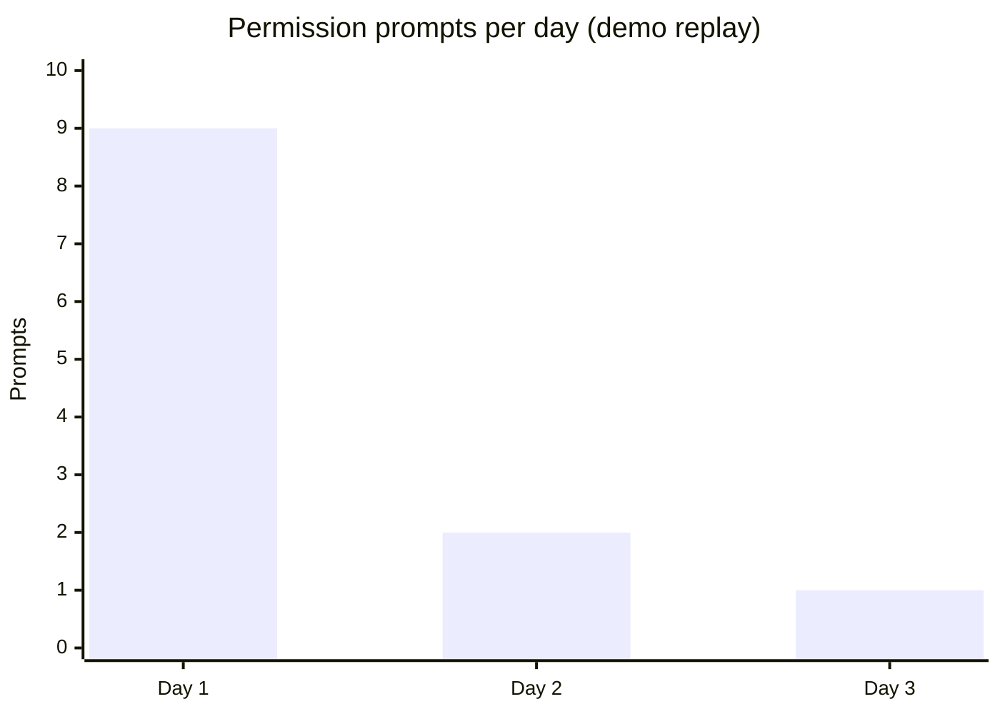

```mermaid
xychart-beta
    title "Before vs after, one replayed session"
    x-axis ["Prompts answered", "Ran without prompt", "Over-edited lines reviewed"]
    y-axis "Count" 0 --> 160
    bar [21, 0, 157]
    bar [11, 19, 0]
```

### The business (cfo.ai)

Full model on cfo.ai: **[cfo.ai/s/0dIxb9IUbPUqQKft](https://cfo.ai/s/0dIxb9IUbPUqQKft)**.
Per developer per month ([`planning/cfo/coding_business_model.md`](planning/cfo/coding_business_model.md),
`make cfo`): ask-every-time **$1,300** · full access **$330** · Solo License **$283**. That is $1,017 saved
per developer against asking every time, about 68× the $15 Team price; $0.48 unit cost (Jev + hosting),
96.8% gross margin, break-even at 276 seats.

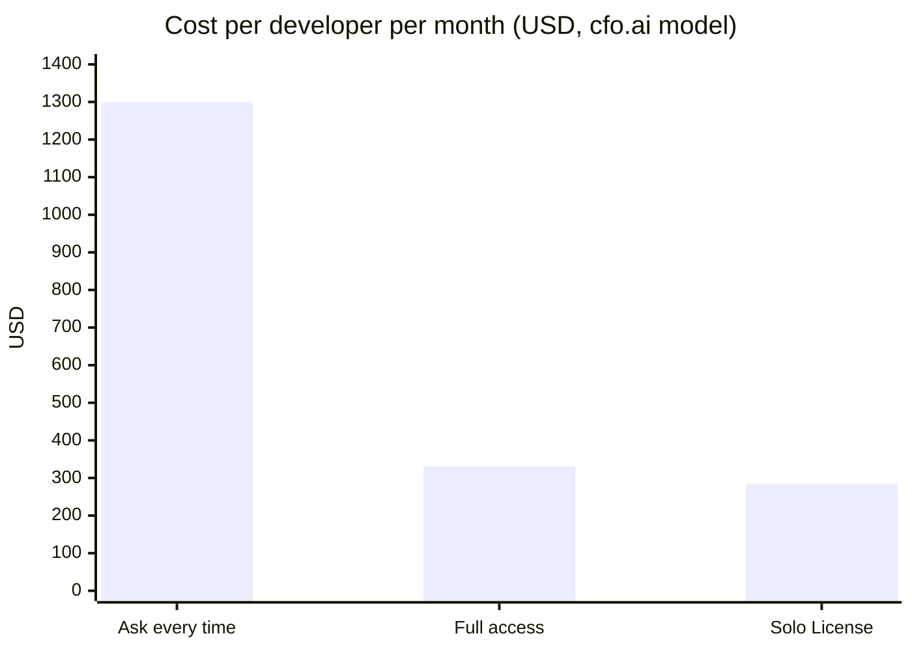

## Compared with the alternatives

| | Ask before changes | Full access / YOLO | Risk classifier (e.g. auto mode) | **Solo License** |
|---|:-:|:-:|:-:|:-:|
| Stops prompt fatigue | no | yes | partly | **yes, once earned** |
| Blocks force-push / `rm -rf ~` | if you read the prompt | no | yes | **yes, at every level** |
| Learns from verified outcomes in *this* repo | no | no | no | **yes** |
| Takes autonomy back after a failure | - | no | no | **yes, one failure → L0** |
| Catches over-editing | no | no | no | **yes, turn sent back** |
| Works across 11 agents | per agent | per agent | one agent | **one gate** |
| Explains each decision (trace + checkpoint) | no | no | partly | **neatlogs + Entire** |
| Fails safe if it is down | - | - | - | **every hook defers** |

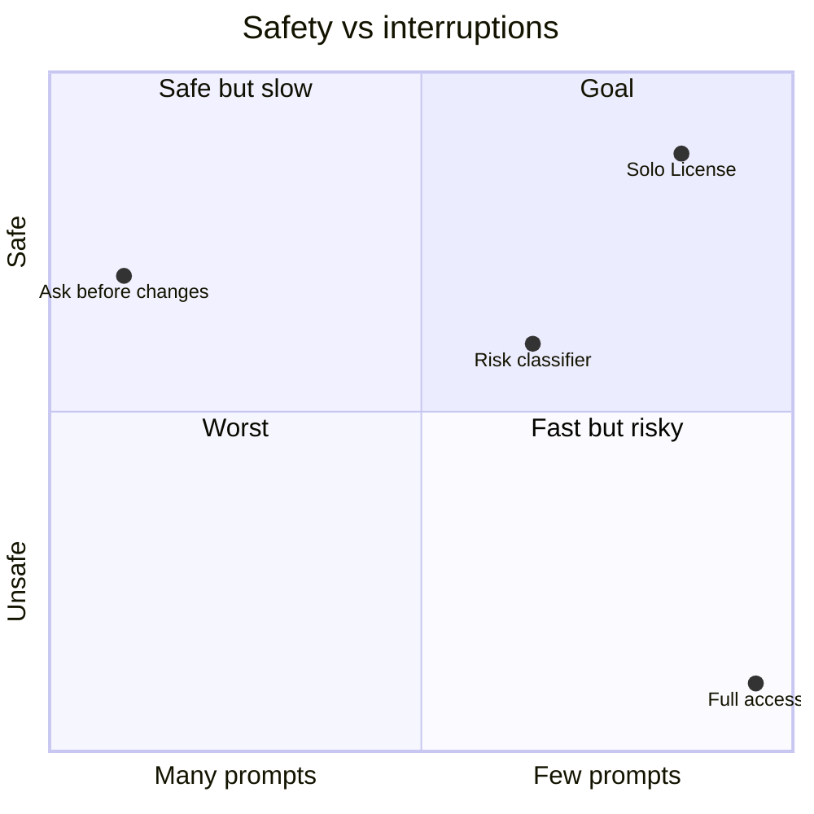

*Positions are our qualitative reading of the table above, not a measurement.*

## How the three hackathon tools are used

**neatlogs - one trace per turn.** `turn.start → gate.allow|ask|deny → tool.ran|failed|observed →
turn.blocked → license.promote|demote → turn.end`, with detections (`forbidden_action`, loops) as error
spans and GenAI attributes on model calls. The before/after replay records all 15 turns as traces (sent to neatlogs when `NEATLOGS_API_KEY` is set).

**Entire - the history behind every license change.** Entire's session id *is* the agent's
`session_id`, so a failed turn points at the last checkpoint of that session; promotions and demotions
are commits; and every pull request in this repo went through Entire Trails and the Entire Gates check -
including review findings that were fixed before merging (injection in hook paths, trust credited from
an agent's own settings, regressions hidden by a cached verdict). Details: [`evidence/entire.md`](evidence/entire.md).

```bash
git -C ~/.solo-license/ledger log --oneline           # how each action class earned and lost its license
entire checkpoint list                                 # the sessions behind the code
```

**cfo.ai - the plan.** The license level is a margin driver: review time saved by earned autonomy
against the incident bill of blind autonomy. Details below.

## How we used cfo.ai

The live model is on cfo.ai: **[cfo.ai/s/0dIxb9IUbPUqQKft](https://cfo.ai/s/0dIxb9IUbPUqQKft)**. The same figures can be
reproduced offline with `make cfo` ([`planning/cfo/coding_model.py`](planning/cfo/coding_model.py)), and the full plan is in
[`coding_business_model.md`](planning/cfo/coding_business_model.md).

**1 · The thesis became a model.** A permission prompt costs developer time, and a mistake costs an incident.
We set up the inputs on cfo.ai:

| Input | Value |
|---|---|
| Developer cost | $75 / hour |
| Prompts in ask mode | 40 / day, 1 min each |
| Over-edited turns | 5 / week, 12 min review each |
| Incidents with full access | 0.05 / month × $600 |
| Share answered by an earned license | 75% (replaced by the measured share once real data exists) |
| Over-edits caught / incidents prevented | 90% / 90% |

**2 · Three ways to run an agent, compared** (per developer per month):

| Mode | Approvals | Over-edit review | Incident risk | **Total** |
|---|---|---|---|---|
| Ask before every change | 800 min | 240 min | $0 | **$1,300** |
| Full access | 0 min | 240 min | $30 | **$330** |
| **Solo License** | 200 min | 24 min | $3 | **$283** |

That is $1,017 saved against asking every time. Against full access it is only $47. That small number is the
honest one: compared with full access, what you are buying is a ceiling on risk.

**3 · Pricing and unit economics.** Plugin free · Team $15/dev/month · Enterprise custom. Cost $0.48/dev/month
(Jev grading $0.08 + hosting $0.40) → **96.8% gross margin**.

**4 · Runway.** $4,000/month fixed costs, $25,000 cash, 50 seats at launch, +30%/month →
**break-even at 276 seats, profitable from month 8**, cash bottoms around $9,800 in month 7, and by month 12
about 896 seats and $13.4k MRR.

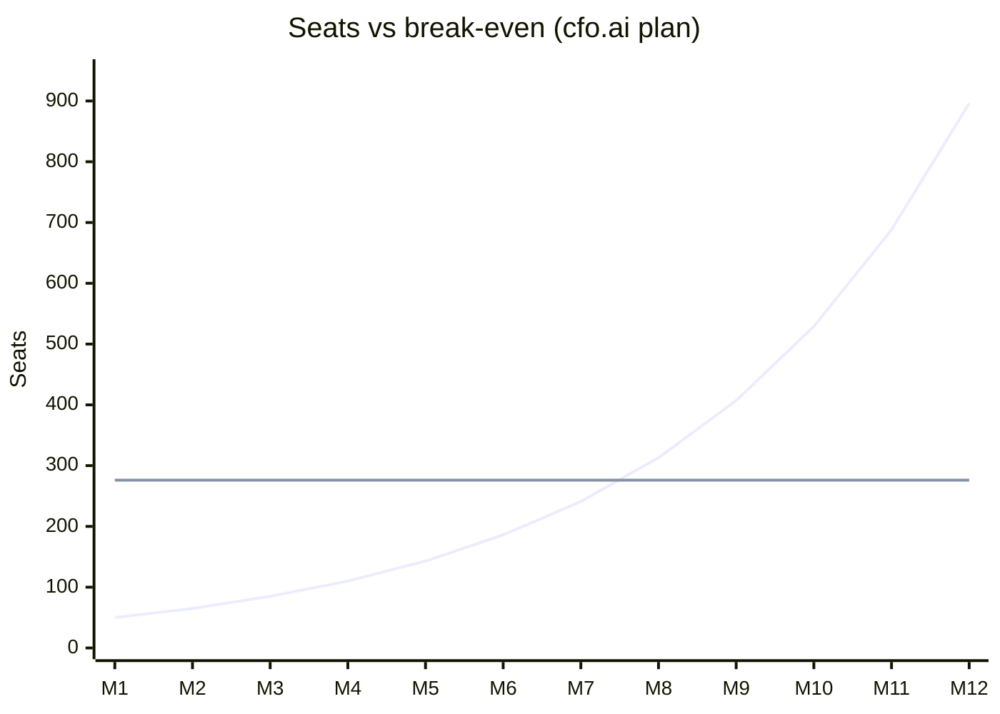

**5 · The model drives the product.** The cfo.ai numbers are not just in a slide. They are used in the code:

| Plan line | Where it lives in the code |
|---|---|
| Developer rate, minutes per prompt | `sololicense/coding/ladder.py` (`DEVELOPER_HOURLY_COST`, `MINUTES_BY_LEVEL`). The same numbers decide promotion. |
| Cost of a mistake per action class | `sololicense/coding/actions.py` (`ACTION_CLASSES[*].incident_cost`) |
| Break-even rule | a class is promoted only when `P(failure) × incident cost < approval cost` |
| Measured savings | `GET /api/coding` → `savings`, from real hook decisions |

So the business model and the trust engine use the same equation. The cfo.ai plan says when autonomy pays
for itself, and the gate promotes a class only at that point.

## neatlogs: one trace per turn

Every agent turn is one trace ([`sololicense/observability/tracer.py`](sololicense/observability/tracer.py)).
Spans go to neatlogs when `NEATLOGS_API_KEY` is set and are always mirrored to the local SQLite `spans` table,
so the dashboard can explain a decision even offline. The before/after replay produced 15 traces
(ids in [`coding_before_after.json`](evidence/benchmarks/coding_before_after.json), e.g. `ac6365e9aee54817b5b8f439712e7b76`).

**Span mix from a recorded preview session** (`data/preview.db`, 3 traces, 25 spans):

| Span | Status | Count |
|---|---|---|
| `turn.start` / `turn.end` / `trace.start` | ok | 3 each |
| `tool.ran` | ok | 4 |
| `gate.ask` / `gate.approved_by_person` | ok | 3 each |
| `gate.allow` | ok | 1 |
| `license.promote` | ok | 1 |
| `gate.deny` | error | 1 |
| `detection.forbidden_action` | error | 1 |
| `turn.blocked` | error | 2 |

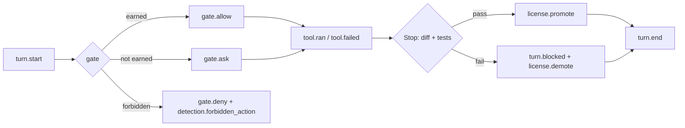

Detections (`forbidden_action`, loops) are error spans, so they surface as incidents in neatlogs;
each dashboard history row deep-links to its trace.

## Entire: logs, checkpoints and trails

### How we used Entire

Entire has two jobs here. **Inside the product** it is the history behind every license change. **During the
build** it recorded how the product was made.

**In the product**

1. **The session id is the same everywhere.** The agent's hook `session_id` is Entire's session id, so a Solo
   License turn and an Entire session line up with no mapping table.
2. **A failed turn points at its checkpoint.** When the `Stop` check fails, `CodingGate._fail` calls
   [`sololicense/coding/entire.py`](sololicense/coding/entire.py) `last_checkpoint()`, which runs
   `entire checkpoint list --json` and stores the last checkpoint of that session on the turn. The dashboard
   shows it next to **Rewind**, and `solo-license explain` prints `entire checkpoint explain <id>`.
3. **Rewind without losing work.** `rewind()` stashes the turn's changes back to the turn's base ref. Nothing is deleted.
4. **Hooks live side by side.** `solo-license init` merges its hooks with Entire's in each agent's config, so both run on every turn.
5. **The ledger follows the same idea.** Each promote, demote, flag and resume is a git commit carrying the reason and the neatlogs trace id.

**In the build**

1. **Checkpoints on every session.** `.entire/settings.json` is enabled with `git-refs` checkpoints. Every
   Claude Code and Codex turn on this repo was saved to a shadow branch (`entire/<sha>-…`), and commits carry an
   `Entire-Checkpoint:` trailer that links code to the prompts that wrote it.
2. **Trails + Entire Gates on every PR.** One branch and one PR per feature. Each PR was merged only after CI
   and the Entire Gates check (approvals, CI, agent review findings, up to date) were green. Review findings fixed
   before merge include injection in hook paths, trust credited from an agent's own settings, a cached verdict
   that hid regressions, and a fail-open in the Windows background stop.
3. **Entire Graph before edits.** `entire graph search / impact` was used to trace symbols before changing them.
   For example, `impact --symbol _fail` showed that all four ways of losing trust go through one method. That is
   why one demotion rule holds for all eleven agents.

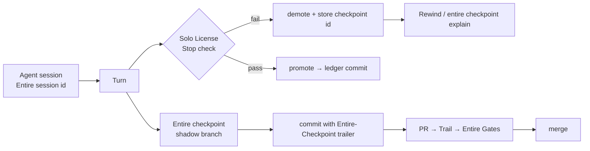

### The numbers

Entire ran on this repository for the whole build. Numbers below come from `.entire/logs/entire.log`,
`entire checkpoint list` and `git log` on 2026-10-13.

| Metric | Value |
|---|---|
| Entire log events | 2,570 |
| Agent sessions recorded | 15 session folders in `.entire/metadata/`, 11 session starts in the current log |
| Turns tracked (`TurnStart`) | 386 |
| Checkpoints saved (log) / listed on `main` | 59 / 31 |
| Commits carrying an `Entire-Checkpoint:` trailer | 28 |
| Pull requests through Trails + Entire Gates | 80+ (122 merge commits) |
| Median Entire hook time | `stop` 1.9 s (38 runs) · `user-prompt-submit` 3.4 s · `pre-push` 4.5 s |

**A turn, as Entire logs it** (trimmed from `.entire/logs/entire.log`):

```text
00:56:52  INFO  turn-start          agent=claude-code  session=72c62de9…
00:56:53  INFO  phase transition    idle -> active
00:57:38  INFO  turn-end            agent=claude-code
00:57:42  INFO  committed changes to shadow branch   entire/6737152-e3b0c4
00:57:42  INFO  checkpoint saved    type=session  count=24  modified_files=4
00:57:42  INFO  phase transition    active -> idle
00:57:42  WARN  perf op=stop 3746ms (write_temporary_checkpoint 2009ms)
```

**Checkpoints → commits** (`git log --format='%h %s | %(trailers:key=Entire-Checkpoint,valueonly)'`):

```text
bfe32a1 docs: the problem section cites verified sources       | 01M4R7Y04GKCP08RZ6YDZCX711
323e862 fix(coding): credential writes and +refspec force-push  | 01M4R7RB6GNV5W0TDA9VJD7TGD
1a46f10 fix(web): masked headline words sit on one line         | 01M4R761HTSJXVTEPT4ZJJMQSJ
408592b feat(coding): MCP tools earn a license per server       | 01M4R1TMHGFAAGTADDEE7AX76V
```

**License ledger trail** (the product's own audit log, [`evidence/benchmarks/coding_ledger_commits.txt`](evidence/benchmarks/coding_ledger_commits.txt)):

```text
15b0848 license(test-run@shop-api): promote L0 -> L1
5cec4d3 license(read@shop-api):     promote L0 -> L1
553b8cf license(test-run@shop-api): promote L1 -> L2
1e505bb license(read@shop-api):     promote L1 -> L2
```

**Trails with Gates:** [trail 48](https://entire.io/gh/JAYATIAHUJA/Solo_license/trails/48) (PR #54) ·
[trail 58](https://entire.io/gh/JAYATIAHUJA/Solo_license/trails/58) (PR #64) ·
[trail 59](https://entire.io/gh/JAYATIAHUJA/Solo_license/trails/59) (PR #65). Review findings fixed before
merge include injection in hook paths, trust credited from an agent's own settings, and regressions hidden by a cached verdict.

**Graph - where a demotion lands:** `entire graph impact --repo . --symbol _fail` shows every path that takes
trust away (forbidden attempt, failed tool, failed turn, subagent stop) going through `CodingGate._fail`.
More: [`evidence/entire.md`](evidence/entire.md).

### Checkpoints you can replay

```bash
entire checkpoint list                       # sessions behind the code
entire checkpoint explain <id>               # prompts, transcript, files of one turn
solo-license explain                         # last failed turn + its Entire checkpoint
git -C ~/.solo-license/ledger log --oneline  # every promote / demote
```

## Build log

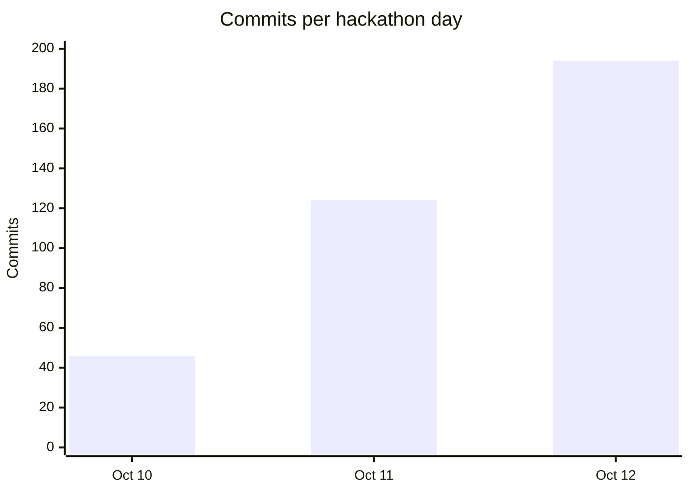

364 commits in three days, one branch + PR per feature, merged only when CI and Entire Gates were green.

**Shortcuts and known rough edges (stated plainly):**

- Entire's `prepare-commit-msg` hook stalled in Git Bash on Windows; those commits were finished without the checkpoint trailer.
- The neatlogs SDK requires Python < 3.14, so the one-liner pins `--python 3.13`; without neatlogs a local span recorder takes over.
- The before/after numbers are a scripted session replayed through the real gate, not a field study.
- Only Claude Code was run end to end with a live agent; the other ten agents are tested against their documented hook payloads.
- `SOLO_DEMO_MODE=1` opens the dashboard without a token and allows any browser origin - for the demo only.
- The product started as a refund-approval agent; that code was removed in v3 ([`evidence/history/`](evidence/history)).

## Evidence for judges

| Requirement | Where |
|---|---|
| An agent completing a task end to end | The coding agent works a repo while the gate plans, gates, verifies (diff + tests), recovers (send back / rewind) and updates trust: [`sololicense/coding/`](sololicense/coding) |
| Before / after with numbers | [`evidence/benchmarks/coding_before_after.md`](evidence/benchmarks/coding_before_after.md) |
| A failure and what happened next | Over-edited turn sent back → reverted → verified; force-push denied and `git-remote` demoted; a regression blocks and demotes `file-edit`; a flagged decision drops the class and tells the agent |
| neatlogs traces | one per turn (trace ids in the benchmark JSON), deep-linked from each history row in the dashboard |
| Entire | Trails and Entire Gates on every PR, checkpoints linked to failed turns, the replay's ledger and its commits: [`evidence/benchmarks/coding_ledger_commits.txt`](evidence/benchmarks/coding_ledger_commits.txt) |
| cfo.ai plan | [`planning/cfo/coding_business_model.md`](planning/cfo/coding_business_model.md) · [screenshot](evidence/assets/screens/cfo-scorecard.png) |
| Tests | `make test` (backend, pytest) and `npm --prefix frontend test`; CI runs both plus the frontend build on every PR |
| Commits during the hackathon | `git log --since=2026-10-10` |

---

## Run it locally

**Requirements:** Python 3.11+, Node 20+, git, [uv](https://docs.astral.sh/uv/) for the one-liners.

```bash
pip install -r requirements.txt
cp .env.example .env                             # sets SOLO_DEMO_MODE=1: "Try the demo" works without a token
uvicorn sololicense.api.app:app --port 8000      # the gate + API
npm --prefix frontend install
npm --prefix frontend run dev                    # http://127.0.0.1:5174 - landing, setup guide, dashboard
make coding-demo                                 # ../shop-api-demo: a repo with two bugs, hooks installed
```

On Windows PowerShell use `Copy-Item .env.example .env`. Without `SOLO_DEMO_MODE=1` (or `SOLO_API_TOKENS`)
the dashboard answers 401 and shows no data: open the app, choose **Try the demo**, enter your name.

Open Claude Code (or any supported agent) in `../shop-api-demo` and ask it to run the tests, then to
fix the bug in `cart.js`. The dashboard shows each decision, each turn's check and every level change.

For a machine-wide install, `solo-license init --global` writes the user-level hook config of every
agent that has one, and `solo-license serve --background` keeps the gate running (`status` / `stop`
manage it, `doctor` checks the gate and the hooks).

| Command | What it does |
|---|---|
| `solo-license init --agent <x>` | Wire an agent's hooks into this repo (`auto`, `all`, or one of the 11); `--global` for user-level, `--dry-run` to preview, `--remove` to uninstall |
| `solo-license serve [--background]` | Run the gate and dashboard · `status` / `stop` for the background gate |
| `solo-license doctor` | Check the gate and this repository's hooks |
| `solo-license policy init` | Write a starter `.solo-license/policy.toml` |
| `solo-license prompt --agent <x>` | Print the self-install prompt |
| `make coding-benchmark` | Before/after replay of a coding session through the real gate |
| `make test` | The backend test suite |
| `make cfo` | The financial model |

Set a Jev key for model-graded turns (rules run without one), `NEATLOGS_API_KEY` for traces, and
`SOLO_API_TOKENS` (`operator` < `approver` < `admin`) to lock the API when deployed.

## Architecture at a glance

```text
                        ┌─────────────────────────────────┐
                        │ Claude Code · Codex · OpenCode   │
                        │ Cursor · Gemini · other agents   │
                        └───────────────┬─────────────────┘
                                        │ native pre / post / stop hooks
                                        ▼
┌─────────────────────────────────────────────────────────────────────────────────┐
│ Local Solo License gate (127.0.0.1)                                               │
│  classify action → apply hard rules + policy → read trust state → allow/deny/defer │
│  end of turn: scope check + regression-aware tests → promote / demote / rewind    │
└──────────────┬────────────────────┬──────────────────────┬────────────────────────┘
               │                    │                      │
               ▼                    ▼                      ▼
       local SQLite state     Git-backed license ledger   neatlogs trace (optional)
       trust, turns, policy   append + focused commit     local mirror always exists
               │                    │                      │
               └────────────────────┴──────────────┬───────┘
                                                    ▼
                                  dashboard · Entire checkpoint · cfo.ai model
```

### Why there is a database

Solo License is **local-first**, but it needs durable facts. SQLite retains the trust record for each
`(repository, principal, action class)`, the evidence behind it, turns, decisions, session spend, and local
operator settings. Without it, restarting the gate would erase an agent's earned permissions and make the
dashboard impossible to audit.

SQLite is not a cloud dependency or a shared SaaS control plane. A standard local install can work without a
remote database. The Git-backed ledger complements it: SQLite is the fast queryable operational state, while the
ledger makes important trust changes human-readable and committed to Git. neatlogs, Entire, and cfo.ai are
integrations around that local core, not prerequisites for the first protected agent run.

### Concurrency: mutexes, `RLock`, and the pthread distinction

The API intentionally shares one local application context and SQLite connection when it is running. The code
uses Python's [`threading.RLock`](sololicense/api/app.py#L39)—a re-entrant mutex—to serialize API paths that read
or change that shared context. This prevents two request threads from interleaving a session update, settings
change, or trust decision around the same connection. It is re-entrant so a protected endpoint may safely call a
helper that also needs the same lock.

There is **no project-authored C/C++ `pthread` implementation** in this repository: no `pthread_create`,
`pthread_mutex_*`, or custom pthread code. On macOS and Linux, CPython may implement Python thread primitives using
the operating system's synchronization facilities internally, but the project-level implementation is the Python
`RLock`. The lock is process-local; the normal `onboard` deployment runs one local gate process. A future
multi-process/server deployment should use a database strategy designed for coordinated multi-process writes rather
than treating this in-process mutex as distributed locking.

## Repository map

```
plugin/solo-license/  Claude Code plugin: hooks, skill, /solo-license:trust
sololicense/coding/   the coding gate
  actions.py          tool call -> action class (incl. mcp:<server>); forbidden commands; chains judged by the riskiest part
  agents.py           11 agents' native hooks <-> the gate's common events (allow / deny / defer)
  gate.py             licenses per (repo, principal, class), decisions, turns, promote / demote / flag / resume
  policy.py           built-in ceilings + committed policy.toml + this machine's rules; subagents, budget, tools
  remediation.py      what the agent is told to undo; queued notes for the next prompt
  loops.py            repeated-call fingerprints: guidance, deny, halt
  digest.py jev.py    bounded session digest and calibrated decisions from Jev (optional)
  budget.py           spend caps read from the agent's transcript
  verify.py           end-of-turn check: diff scope, tests compared test by test against the turn's start
  ladder.py           floor + economic bound per class
  entire.py           Entire checkpoint of a failed turn; rewind
  install.py shim.py global_install.py   per-agent config writers; the one-file command-hook shim
sololicense/cli.py    solo-license init | serve | status | stop | doctor | policy | prompt | hook
sololicense/          shared: domain (trust maths), services (git ledger, economics), observability (neatlogs), db
frontend/             landing page, setup guide, dashboard (Coding, History, Settings)
planning/cfo/         financial model and plan
demo/shop-api/        the demo repository
```

## What is new here, and what is not

Graduated autonomy is not new (*Levels of Autonomy for AI Agents*, Feng et al., 2025; AWS's
graduated-autonomy pattern), permission hooks are not new, and Claude Code's auto mode already
classifies risky actions. Solo License adds:

1. **Autonomy earned from verified outcomes, per repo and per kind of action** - promoted only when the
   evidence beats the break-even of a mistake's cost, and taken back by one failure.
2. **Over-editing as a trust signal** - a turn whose diff is out of proportion to the request is sent back,
   and counts against the agent.
3. **One gate for every agent** - the same earned trust, enforced through each agent's own hooks, per
   principal (main agent and each subagent type) and per MCP server.
4. **A control layer a person can steer live** - flag a decision and the agent hears about it on its next prompt.

Limits we state plainly: only Claude Code has been run end to end with a live agent; the other agents'
hook formats follow their documentation and are tested with their documented payloads. The demo
benchmark is a scripted session replayed through the real gate, not a field study.

*History: Solo License began as a support agent that earned the right to issue refunds. That product
was removed in v3 so the repository tells one story; the trust engine, ledger and economics carried over.*
