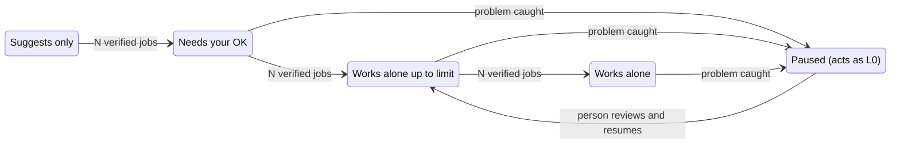
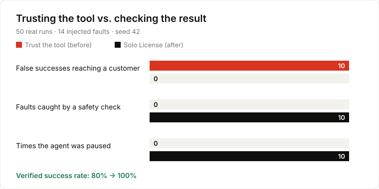
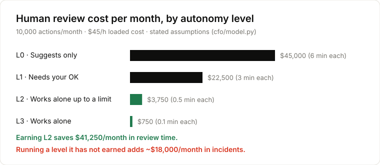
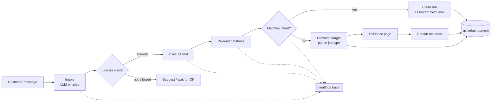

<div align="center">

# Solo License

**A driving license for AI agents.**<br/>
The agent starts by asking permission, earns freedom one verified job at a time,
and is paused the instant something goes wrong — until a person reviews and resumes it.

*Earned. Revocable. Priced.*

Built for the [neatHack AI agent hackathon](https://neatlogs.com/hackathon) · uses **neatlogs**, **Entire** and **cfo.ai** · by [@JAYATIAHUJA](https://github.com/JAYATIAHUJA)

</div>

---

## The problem

Today you either watch every action an AI agent takes, or you let it run and hope.
Agents also *lie by accident*: a tool says "Refund processed" while nothing moved.
If you trust that response, the mistake reaches your customer.

## What Solo License does

| | |
|---|---|
| **Starts cautious** | Every job type (refunds, store credit) begins at *Suggests only* or *Needs your OK*. |
| **Checks, never trusts** | After every action the agent re-reads the database. The tool's "success" message is ignored. |
| **Earns freedom** | After *N* double-checked jobs in a row, that job type moves up one level — automatically. |
| **Stops instantly** | Any caught problem pauses that job type at once. Other job types keep their own level. |
| **A person decides** | One evidence page shows what was meant, what happened and why it stopped. A person resumes it at a level they choose. |
| **Everything is recorded** | Every permission change is a git commit (explainable with Entire); every run is a neatlogs trace. |

### The four levels

| Level | In the app | What the agent may do alone |
|---|---|---|
| L0 | **Suggests only** | Nothing — it suggests, you act |
| L1 | **Needs your OK** | Prepares each job; you approve with one click |
| L2 | **Works alone up to $50** | Jobs under the limit; bigger ones wait for you |
| L3 | **Works alone** | Everything, reviewed afterwards |



---

## Results

### Before / after — trusting the tool vs. checking the result

50 real runs through the worker with 20 % injected faults (seeded, reproducible):

<p align="center"></p>

| | Trust the tool | Solo License |
|---|---|---|
| False successes reaching a customer | **10 / 50** | **0 / 50** |
| Verified success rate | 80 % | 100 % |
| Problems caught and paused | 0 | 10 |
| Mean / p95 latency per run | — | 84 ms / 320 ms |

Reproduce: `python -m scripts.benchmark` → [`artifacts/benchmark.md`](artifacts/benchmark.md)

### Autonomy is a margin driver

<p align="center"></p>

From stated assumptions in [`cfo/model.py`](cfo/model.py) (10,000 actions/month, $45/h loaded cost):

- Earning **L2** saves **$41,250 / month** in review time → **+20.3 % margin**.
- Running a level the agent has *not* earned (blind full-auto) adds ~$18,000 / month in incidents → **−73.4 % margin**.

The app recomputes this live from your own runs on the **Reports** page — the number visibly drops when a job type is paused.

---

## How one run works



*The model proposes, the license decides, the database proves.* The LLM only reads the
message and writes a plan — it never decides what is allowed.

Problems the safety checks catch:

| Check | Plain meaning |
|---|---|
| `state_mismatch` | The tool said "done", but nothing changed |
| `policy_breach` | The agent acted beyond its permission |
| `missing_verification` | The result was never double-checked |
| `duplicate_action` | The same action ran twice |
| intake guard | The message tries to change the agent's rules ("ignore your rules…") → sent to a person |

---

## How the three hackathon tools are used

### neatlogs — the trust signal
- Every run is one **workflow trace** (`solo-license`) with spans for `license.check → plan → tool → verify.readback → detection.*`; caught problems are marked as **error spans**.
- LLM calls (Gemini, Claude, OpenAI) are wrapped with `neatlogs.wrap`, so the model call sits inside the same trace.
- The evidence page deep-links to the trace. Code: [`sololicense/observability/`](sololicense/observability).

### Entire — the audit trail
- Every promote / pause / resume is one scoped commit of [`ledger/license_ledger.jsonl`](ledger/license_ledger.jsonl) with the reason, run and trace id.
- Entire checkpoints are enabled for Claude Code and Codex sessions ([`.entire/settings.json`](.entire/settings.json)).

```bash
git log --oneline -- ledger/license_ledger.jsonl     # how each job type earned and lost its license
entire checkpoint explain <sha>                       # why a change was made
entire graph impact --repo . --symbol execute_refund  # what the side-effecting tool touches
```

### cfo.ai — the margin story
- [`cfo/model.py`](cfo/model.py) turns stated assumptions into a supervision-cost curve, over-promotion risk and a P&L; narrative in [`cfo/business_model.md`](cfo/business_model.md).
- The plan with pricing, costs, revenue and runway (4 scenarios) is built in cfo.ai through its MCP from these files and the benchmark.

---

## Evidence for judges

| Requirement | Where to find it |
|---|---|
| Real end-to-end agent task | Refund + store-credit worker: intake → license → execute → read-back → detections → dial ([`worker.py`](sololicense/agent/worker.py)); try it in **Try the agent** |
| Two runs with compared numbers | [`artifacts/benchmark.md`](artifacts/benchmark.md) (10/50 → 0/50) · `python -m scripts.generate_evidence` for a single clean-vs-fault pair |
| neatlogs traces / detections | Benchmark runs were exported to neatlogs; detections are error spans per run |
| A failure and what the agent did next | Guided tour step 4–8: practice problem → paused → evidence → person resumes |
| Entire checkpoints / graph | 26 ledger commits: `git log -- ledger/license_ledger.jsonl`; `entire checkpoint list` |
| cfo.ai plan (pricing, costs, revenue, runway) | [`cfo/`](cfo) + plan built in cfo.ai via MCP |
| Commits during the hackathon | `git log --since=2026-10-10` |
| Tests | `python -m pytest` — 70 tests (state machine, detections, worker, API, ledger isolation, intake safety) |

---

## Run it locally

**Requirements:** Python 3.11+, Node 20+, git.

```bash
pip install -r requirements.txt
cp .env.example .env             # SOLO_DEMO_MODE=1 is already on; keys are optional
python -m sololicense.db.seed    # demo orders; refunds start at L2, store credit at L1
uvicorn app.api:app --port 8000  # API
npm --prefix frontend install
npm --prefix frontend run dev    # http://127.0.0.1:5174
```

Open the app → **Try the demo** → type your name. On **Home**, click **Watch a 1-minute demo**:
a guided tour opens each screen, highlights what matters and runs the whole loop for real.

**Optional keys** (Settings → AI model / Connections, or `.env`):
`GEMINI_API_KEY` / `ANTHROPIC_API_KEY` / `OPENAI_API_KEY` / any OpenAI-compatible endpoint,
`NEATLOGS_API_KEY` for remote traces, and a Slack/Discord webhook for pause alerts.
Without a model the agent uses built-in rules — the safety is identical, because authority
never comes from the model. Keys saved in Settings are encrypted at rest.

For a deployment, turn demo mode off and issue role-based access codes with
`SOLO_API_TOKENS` (`operator` < `approver` < `admin`). Set `SOLO_LEDGER_REPO=.` to commit
license changes into this repository so Entire can explain them.

| Command | What it does |
|---|---|
| `make test` | Run the test suite |
| `make seed` | Reset the demo database |
| `make benchmark` | Re-run the 50-run before/after benchmark |
| `make charts` | Redraw the README charts from the latest data |
| `make cfo` | Print the financial model |

---

## Architecture

```
frontend/        React app — sign-in, onboarding, Home, Try the agent, Activity, Reports, History, Settings
app/api.py       FastAPI adapter: sessions, roles, settings (encrypted secrets), dashboard
sololicense/
  agent/         intake (LLM or rules), planner, worker loop, tools
  domain/        pure license state machine + task-class registry
  services/      verification, license service, git ledger, evidence, economics, alerts
  observability/ neatlogs tracer + detection rules
  db/            SQLite schema, migrations, repositories
cfo/             financial model and plan
scripts/         benchmark, evidence pair, README charts
```

Dependencies point inward: `domain` has no I/O and is unit-tested on its own.

## Honest positioning

Graduated autonomy is not new — AWS described "graduated autonomy" (Aug 2026), and there is
research and practitioner work on earned permission ladders. Solo License does not claim the
ladder. What it adds: **demotion driven by detections on verified side effects**, **one
evidence page a person uses to resume**, and **the license level treated as a priced margin
driver**.
